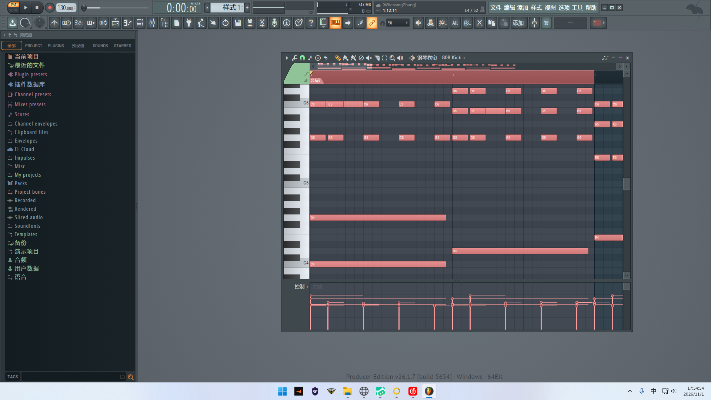

# dsh-fl-mcp

**让 AI 直接把编曲写进 FL Studio 的钢琴卷帘。** 一个 MCP（Model Context Protocol）服务器，
给 DeepSeek Harness（DSH）、WorkBuddy、Claude Desktop 等任何支持 stdio MCP 的客户端用。

不装虚拟 MIDI 驱动、不要管理员权限、不用在 FL 里点菜单——AI 说「写个贝斯」，
它自己启动 FL、自己打开钢琴卷帘、自己导入音符、再把 FL 里的东西导出来核对一遍。



> 上图是真机跑出来的：AI 生成 8 小节流行钢琴声部，直接落在 FL 的钢琴卷帘里。

---

## 它能干什么

| 能力 | 说明 |
|---|---|
| **六声部编曲** | 钢琴 / 鼓 / 电吉他 / 木吉他 / 贝斯 / 弦乐，各自的音域、音色、织体规则都写在引擎里 |
| **7 种风格 × 大小调** | pop / rock / ballad / orchestral / jazz / lofi / chinese，大调小调都走功能序进 |
| **和声不是随机** | 内核是斯波索宾和声体系：T→S→D→T、终止式收束、小调借用 III/VII 避开增三减三 |
| **主动规避平行五八度** | 不是事后报告，是在候选织体里按「平行代价 + 声部移动」评分选优 |
| **写完能对账** | 导回 MIDI 解析，音符数 / 音高 / 起点 / 时值逐条比，`fl_read_score` 给结论 |
| **零第三方自动化依赖** | 不用 loopMIDI、不用 pyautogui 点菜单，走 FL 官方快捷键 + 标准文件对话框 |

---

## 环境要求

- **Windows**（本项目的 GUI 自动化只做了 Windows）
- **FL Studio 21 或更新**（实测 26.1.7；用到的 `Ctrl+M` / `Shift+Ctrl+M` 是官方快捷键）
- **Python 3.10+**
- FL 可以装在非标准路径（用 `FL_STUDIO_DIR` 指定即可）

---

## 安装

```bash
git clone https://github.com/KovacBro/dsh-fl-mcp.git
cd dsh-fl-mcp

python -m venv .venv
.venv\Scripts\python -m pip install -r requirements.txt
.venv\Scripts\python install.py --dsh "E:\你的DSH工作区"
```

`install.py` 会做四件事：探测 FL → 装可选的桥接脚本 → 注册 MCP → 自检。

参数：

| 参数 | 作用 |
|---|---|
| `--dsh <目录>` | 指定 DeepSeek Harness 工作区（可重复写多个） |
| `--scan-drives` | 扫各盘根目录找 DSH 工作区（默认不扫，免得乱动别人的目录） |
| `--no-dsh` | 只注册 WorkBuddy，不碰 DSH |

FL 装在非标准盘就加一句：

```bat
set FL_STUDIO_DIR=D:\fls
```

---

## 接到 DeepSeek Harness

DSH 的 MCP 配置是**工作区级**的：每个工作区一份 `.dsh/mcp.servers.yml`。
`install.py --dsh` 已经帮你追加好了，长这样：

```yaml
servers:
  flstudio:
    transport: stdio
    command: "E:/path/to/dsh-fl-mcp/.venv/Scripts/python.exe"
    args:
      - "E:/path/to/dsh-fl-mcp/mcp/flstudio_mcp_server.py"
    env:
      FL_STUDIO_DIR: "D:/fls"
      PYTHONIOENCODING: "utf-8"
    toolCallTimeoutMs: 180000      # 写一次声部要开关窗口，给足 3 分钟
```

**新开一个会话**就能看到 9 个 `fl_*` 工具（不用重启 DSH）。

> `toolCallTimeoutMs` 别省：默认 60 秒不够，`fl_setup` 启动 FL 就要 5–30 秒。

---

## 接到 WorkBuddy / Claude Desktop / 其他客户端

同一份 stdio 配置，按客户端该放的位置放：

```json
{
  "mcpServers": {
    "flstudio": {
      "command": "E:\\path\\to\\dsh-fl-mcp\\.venv\\Scripts\\python.exe",
      "args": ["E:\\path\\to\\dsh-fl-mcp\\mcp\\flstudio_mcp_server.py"],
      "env": { "FL_STUDIO_DIR": "D:\\fls", "PYTHONIOENCODING": "utf-8" }
    }
  }
}
```

- **WorkBuddy**：`%USERPROFILE%\.workbuddy\mcp.json`（装完去连接器页点【信任】再重启会话）
- **Claude Desktop**：`%APPDATA%\Claude\claude_desktop_config.json`
- **其他**：认 stdio 的 MCP 客户端都行，`command` 给解释器、`args` 给脚本路径

---

## 9 个工具

| 工具 | 干什么 | 什么时候用 |
|---|---|---|
| `fl_status` | 自检：FL 路径 / 版本 / 是否在跑 | 第一次，或怀疑环境有问题时 |
| `fl_setup` | 需要时自己启动 FL、自己打开钢琴卷帘 | 每次开工第一步 |
| `fl_compose` | 生成六声部，同时落一份多轨 `.mid` | 定风格 / 调 / 小节数 / BPM |
| `fl_write_voice` | 把某个声部写进当前钢琴卷帘（默认先清空） | 逐声部落盘 |
| `fl_read_score` | 从 FL 导出 MIDI 再解析，给写入结果对账 | 写完必跑 |
| `fl_clear_score` | 清空当前钢琴卷帘 | 重来一遍时 |
| `fl_export_midi` | 导出六轨 `.mid` | 想一次看到六条轨道 |
| `fl_push_voice` | 走脚本桥接写音符（老路径，保留兼容） | 一般不用 |
| `fl_install_bridge` | 把桥接脚本装进 FL 脚本目录 | 想用和弦标记功能时 |

### 标准顺序

```
fl_setup → fl_compose → fl_write_voice(piano) → fl_read_score
                          ↓
                     fl_write_voice(bass / drums / strings / …) → fl_read_score
```

FL 的钢琴卷帘是**通道级**的，一次只显示一个通道，所以六个声部要分六次写。
想一次拿六轨：`fl_export_midi`，把生成的 `.mid` 拖进播放列表。

---

## 怎么跟 AI 说

接好之后不用记工具名，直接说话：

> 「用 pop 风格 C 大调写 8 小节，96 BPM，贝斯直接写进 FL」

> 「换成 Am 小调的抒情版，弦乐写好之后把和弦走向报给我」

> 「先写鼓，再把整首导成六轨 MIDI 给我」

AI 会自己判断该调 `fl_setup`、`fl_compose`、`fl_write_voice` 还是 `fl_read_score`。
想让它按固定流程走，就把上面的「标准顺序」贴给它。

---

## 验证（换客户端后先跑这个）

`tools/doctor.py` 不猜配置——它**直接读客户端自己的配置文件**，按里面的
`command` / `args` / `env` 把服务器拉起来，走完整握手，`--live` 还会真写一遍 FL：

```bash
.venv\Scripts\python tools\doctor.py --config "E:\你的DSH工作区\.dsh\mcp.servers.yml" --live
```

真实输出：

```
[1] initialize    -> flstudio-arranger v1.0.0  protocol=2024-11-05
[2] tools/list    -> 9 个工具：fl_status, fl_install_bridge, fl_compose, ...
[3] fl_status     -> FL 找到=True 版本=26.1.7 运行中=False 目录=D:/fls
[4] fl_setup      -> OK  5.3s
[5] fl_compose    -> OK  ...\arrange_pop_C_8bar.mid
[6] fl_write_voice-> OK  写入 137 音
[7] fl_read_score -> OK  读回 137 音  音域 [41, 84]
    闭环核对：写 137 / 读 137 -> 一致 ✓
```

`.json` 形式的配置也能读（`--config ...\mcp.json`）。

---

## 工作原理

FL 只开放了一个能写音符的口子：**钢琴卷帘脚本 API**（`flpianoroll`）。
但想跑脚本得点工具菜单里的两栏自绘面板——位置随主题和窗口布局变。
GitHub 上现成的 FL MCP 基本都卡在这一步：

| 路线 | 问题 |
|---|---|
| 虚拟 MIDI 端口（loopMIDI） | 要装内核驱动 + 管理员权限，而且 FL 的 MIDI 脚本 API **没有音符接口** |
| pyautogui / AHK 点菜单 | 硬编码坐标，布局一变就翻车（本项目实测过：中途误开混音器，位置全变） |
| **本项目：官方快捷键 + 标准对话框** | `Ctrl+M` 导入 / `Shift+Ctrl+M` 导出，全程键盘可达，任何版本通用 |

写入：生成单声部 `.mid` → `Ctrl+M` → 文件对话框打字回车 → 点「接受」→ 音符进去。
回读：`Shift+Ctrl+M` → 导出 → 解析 MIDI → 和源音符逐条比。

---

## 踩过的坑（改代码前先看）

1. **FL 不接受同一音高的重叠音符**：旋律撞织体时它会**把长音切开**，回读音符数变多。
   引擎里 `fl_safe()` 统一修（同起点合并、被压住的截断），修了几处写进报告 `note_fixes`。
2. **点钢琴卷帘的网格会画出一个音符**（默认力度 100）。聚焦只能点左侧键盘条，否则每次写入都多一个音。
3. **FL 的导入是追加语义**，不清空就叠加。`import_midi_to_pianoroll(clear_first=True)` 默认先 `Ctrl+A`/`Delete`。
4. **播放列表和钢琴卷帘是同一个窗口类** `TEventEditForm`，只按类名抓会抓到播放列表，必须看标题条文字。
5. **`F7` 是开关不是「打开」**：已经开着再按会关掉。
6. **文档目录可能被重定向**（比如 `D:\Backup\Documents`）。`~/Documents` 会指错，必须 `SHGetKnownFolderPath`。
7. **FL 里的音名比标准高一个八度**：MIDI 60 = 科学音高 C4 = FL 显示 C5。
8. **FL 的 Python 沙箱里 `os.replace` 会失败**（只用桥接脚本时相关）：能写 `.tmp`，替换被拒。

---

## 目录结构

```
dsh-fl-mcp/
├─ install.py                  一键安装（探测 FL + 注册客户端 + 自检）
├─ mcp/
│  ├─ flstudio_mcp_server.py   MCP 服务器（stdio，零第三方依赖）
│  ├─ fl_core.py               FL 探测 / 窗口 / 队列
│  ├─ fl_gui.py                截屏、点击、对话框、导入导出
│  ├─ fl_voices.py             六声部写作器 + 平行五八度检查 + fl_safe
│  ├─ harmony_engine.py        斯波索宾和声引擎
│  ├─ midi_writer.py           多轨 MIDI 写出
│  └─ midi_reader.py           MIDI 解析（回读用）
├─ fl_scripts/
│  └─ MCP_Bridge.pyscript      FL 钢琴卷帘桥接脚本（可选）
├─ tools/
│  ├─ doctor.py                跨客户端健康检查（--live 真写 FL）
│  ├─ selftest.py              桥接链路自检（假 FL，不依赖 GUI）
│  ├─ mcp_smoke.py             MCP 协议冒烟测试
│  └─ probe.py / shot.py       调试用：截图、发按键
├─ references/
│  ├─ 01-instrument-voicing.md 六声部乐器法与平行五八度判定口径
│  ├─ 02-workflow.md           FL 里从音符到成品
│  └─ 03-github-survey.md      GitHub 现成 FL MCP 的调研与选型
├─ agents/
│  └─ fl-studio-arranger.md    可选：包成专家团的 agent 定义
├─ demo/                       示例 MIDI 与真机截图
└─ SKILL.md                    另一个形态：给支持 Skill 的客户端当技能包用
```

---

## 已知限制

- **一次只能写一个通道**：FL 钢琴卷帘是通道级的，切通道这一步还得手动点（或另做通道机架自动化）。
- **要 FL 在前台**：自动化会切前台并点击，跑的时候别抢鼠标。
- **只支持 Windows**：`fl_gui.py` 走 `ctypes` 调 Win32 / SendInput。
- **不生成音色**：谱子只是音符，音源用你自己的（FL 原生或第三方 VST）。
- **桥接脚本是可选件**：只有想往时间轴写 `I / V / vi` 和弦标记时才需要，主链路不依赖它。

---

## 许可

MIT。FL Studio 是 Image-Line 的商标，本项目为第三方工具，与 Image-Line 无关联。
